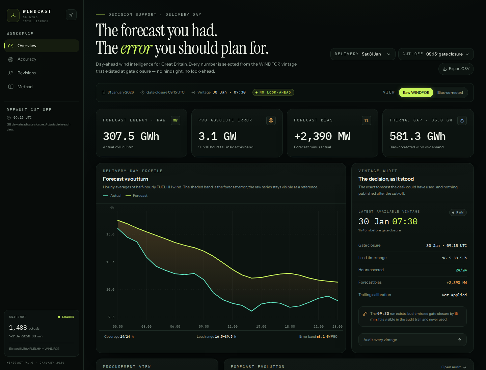
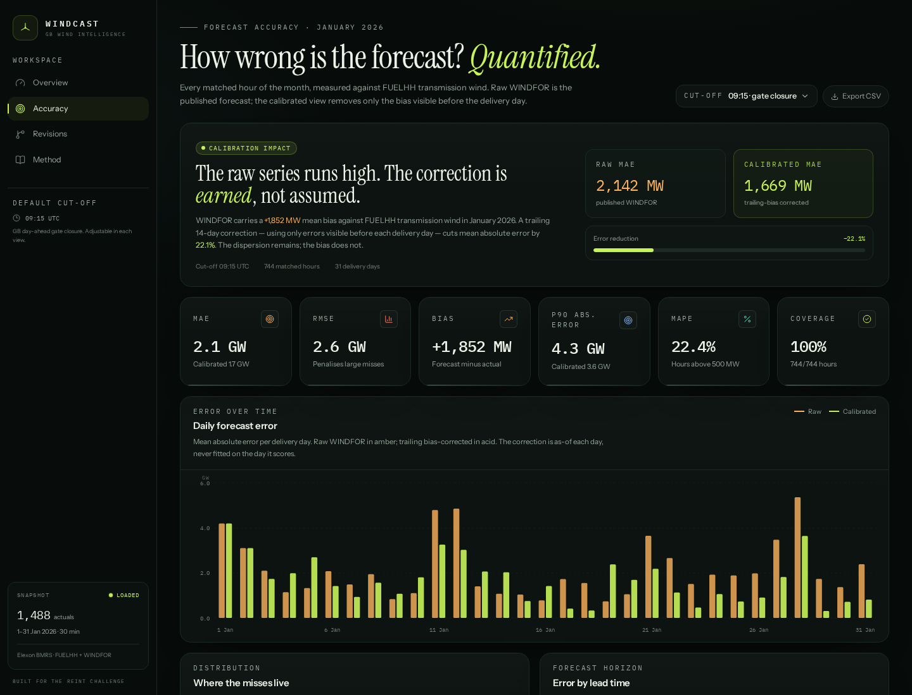
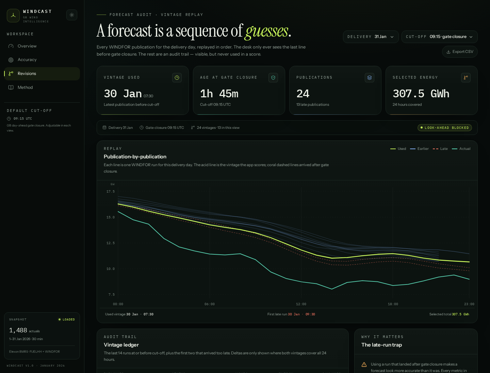
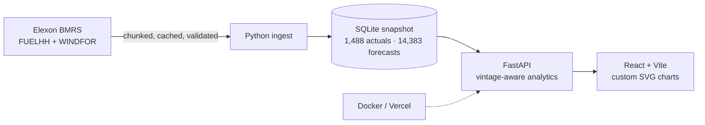

# Windcast

**Day-ahead wind forecast intelligence for a GB energy utility.**
Vintage-aware. Error-quantified. No look-ahead.

**[Live app →](https://windcast-pilot.vercel.app)** · **[Method →](https://windcast-pilot.vercel.app/method)** · **[GitHub →](https://github.com/subhajitlucky/kjhwr)**



---

## The problem

A GB utility must buy electricity one day ahead to cover the gap between
weather-dependent wind generation and its customers' demand. The desk needs two
things at gate closure:

1. the **latest wind forecast that actually existed at that moment**, and
2. a **quantified view of how wrong forecasts like it have been**.

Windcast is a pilot that does both for national wind in **January 2026**, using
only Elexon's `FUELHH` actuals and `WINDFOR` forecasts.

## What it does

| View | What it answers |
|---|---|
| **Overview** | What was the latest usable forecast for this delivery day? What energy does it imply, how large is the error, and what thermal gap does it leave at a chosen demand level? |
| **Accuracy** | How wrong was the forecast across the month? MAE, RMSE, bias, P90 absolute error, MAPE, coverage, error by lead time, distribution and worst days — raw and bias-corrected. |
| **Revisions** | How did the forecast for this day evolve publication by publication? Which run was usable at gate closure, and which runs arrived too late? |
| **Method** | Every assumption, the vintage rule, metric definitions, caveats and architecture. |

The default delivery day is **31 January 2026** and the default cut-off is
**09:15 UTC**, the GB day-ahead gate closure.

## The rule that makes it honest

A forecast is a sequence of publications, not a single number. For every
delivery hour, Windcast uses the **most recent WINDFOR publication at or before
the cut-off**:

```sql
SELECT max(publish_time)
FROM wind_forecast
WHERE publish_time <= :cutoff
  AND start_time  = :delivery_hour
```

The 07:30 run is the last one normally available before 09:15. The 09:30 run is
kept in the audit trail but **never selected**, because using it would leak
information the desk did not have. Every metric on every page applies the same
rule.

## What the data says

Across 744 matched hours in January 2026:

| Metric | Raw WINDFOR | Trailing bias-corrected |
|---|---:|---:|
| MAE | **2,142 MW** | **1,669 MW** (−22.1%) |
| Bias | **+1,852 MW** | ≈ 0 |
| P90 absolute error | **4,300 MW** | ~3,600 MW |

The raw WINDFOR series runs consistently high against FUELHH transmission wind.
The app reports the raw comparison and offers a transparent, as-of calibration:
the trailing 14-day mean error is subtracted from the forecast. The correction
is fitted only on prior days, so the calibrated score is out-of-sample. The
dispersion remains — which is exactly what a procurement buffer is for.

> **Caveat:** FUELHH and WINDFOR are not perfectly like-for-like. The measured
> bias is consistent with a scope difference (transmission-metered vs total or
> available wind, curtailment) as well as forecast error. Windcast makes that
> explicit and keeps raw and corrected views side by side.

## Screens

| Accuracy | Revisions |
|---|---|
|  |  |

## Architecture



- **Frontend:** React 19, TypeScript, Vite, Tailwind CSS, hand-built SVG charts.
- **Backend:** Python 3.12, FastAPI, SQLite (stdlib `sqlite3`), httpx for ingest.
- **Data:** Elexon BMRS public API; raw responses cached as gzipped JSON.
- **Delivery:** one Docker image serving both the API and the built SPA; the same
  app is deployed to Vercel as a FastAPI function with CDN static assets.

## Project structure

```
windcast/
├── backend/
│   ├── app/
│   │   ├── api/routes.py          # HTTP endpoints + CSV exports
│   │   ├── services/
│   │   │   ├── elexon.py          # chunked, cached API client
│   │   │   ├── ingest.py          # clean, validate, write SQLite
│   │   │   └── analytics.py       # vintage selection, calibration, metrics
│   │   ├── config.py              # analysis window + gate-closure constants
│   │   ├── db.py                  # schema, read-only serverless support
│   │   └── main.py                # FastAPI app + SPA serving
│   ├── tests/                     # 16 pytest cases
│   └── requirements*.txt
├── frontend/
│   ├── src/
│   │   ├── components/charts/     # forecast, revisions, bars, histogram, scatter
│   │   ├── pages/                 # Overview, Accuracy, Revisions, Method
│   │   ├── context/AppState.tsx   # URL-driven date/cut-off/calibration state
│   │   └── lib/                   # API client, types, formatting, hooks
│   └── package.json
├── data/windcast.db               # committed January 2026 snapshot
├── docs/
│   ├── video-script.md            # 10-minute demo script
│   ├── submission-checklist.md
│   └── screenshots/
├── Dockerfile                     # multi-stage: React build → Python runtime
├── docker-compose.yml
├── vercel.json                    # FastAPI framework deployment
├── heroku.yml
├── Makefile
└── README.md
```

## Run it

### Docker (recommended)

```bash
docker compose up --build
# open http://localhost:8000
```

The image builds the React app, copies the SQLite snapshot, installs the Python
dependencies and runs FastAPI with Uvicorn. The same image works on Heroku.

### Local development

```bash
make install      # backend venv + frontend node_modules
make ingest       # optional: rebuild the January 2026 snapshot from Elexon
make api          # FastAPI on http://localhost:8000
make web          # Vite on http://localhost:5173 (proxies /api)
```

Or run the production build locally:

```bash
make serve        # builds the frontend, serves everything on :8000
```

### Tests

```bash
make test
# 16 passed
```

The suite covers the critical vintage-selection rule, half-hour → hourly
aggregation, trailing calibration, API contracts, validation errors, CSV
exports and ingest cleaning.

## Deploy

### Vercel (live)

**Live URL:** https://windcast-pilot.vercel.app

```bash
vercel --prod
```

The deployment uses Vercel's FastAPI framework support. The build command builds
the Vite app and copies the SQLite snapshot into the static mount directory so
it survives function packaging. The function opens the snapshot with
`mode=ro&immutable=1`, which is required on Vercel's read-only filesystem.

### Heroku

`heroku.yml` and the root `Dockerfile` are included:

```bash
heroku create
heroku stack:set container
git push heroku main
```

Heroku requires a paid dyno; the container binds to `$PORT` automatically.

## API

| Method | Endpoint | Purpose |
|---|---|---|
| GET | `/api/health` | Liveness + row counts |
| GET | `/api/meta` | Dataset coverage, snapshot metadata, defaults |
| GET | `/api/forecast/latest?delivery_date=2026-01-31&cutoff=09:15&calibrated=false` | Selected vintage, day summary, hourly series |
| GET | `/api/forecast/revisions?delivery_date=2026-01-31&cutoff=09:15` | Every publication for the day, with availability at cut-off |
| GET | `/api/accuracy?start=2026-01-01&end=2026-02-01&cutoff=09:15` | Monthly metrics, daily rows, lead-time buckets, histogram, scatter |
| GET | `/api/procurement?delivery_date=2026-01-31&demand_gw=35&cutoff=09:15` | Thermal gap, P90 buffer, hourly residual series |
| GET | `/api/export/forecast.csv?...` | Day ledger as CSV |
| GET | `/api/export/accuracy.csv?...` | Daily accuracy ledger as CSV |

OpenAPI docs are available at `/docs` when running the API.

## Data

- **Actuals:** [Elexon FUELHH](https://bmrs.elexon.co.uk/api-documentation/endpoint/datasets/FUELHH/stream), `fuelType=WIND`, 30-minute resolution.
- **Forecasts:** [Elexon WINDFOR](https://bmrs.elexon.co.uk/api-documentation/endpoint/datasets/WINDFOR/stream), `publishTime` + `startTime`, hourly.
- **Window:** delivery 1–31 January 2026; forecast publications from 28 December 2025 to 1 February 2026.
- **Snapshot:** 1,488 actual half-hours, 14,383 forecast rows, 264 publications. Committed at `data/windcast.db` for reproducibility.

## Limitations

- **Like-for-like:** FUELHH measures transmission-metered wind; WINDFOR may cover
  a broader scope. Raw error therefore contains a structural component. The
  calibration layer is transparent, not a claim that the forecast model is wrong.
- **Demand is an assumption.** There is no demand dataset in scope; the slider is
  an illustrative operator input, not a measured value.
- **No prices.** The app sizes MW/MWh, not £/MWh, imbalance risk or unit
  commitment.
- **Static snapshot.** January 2026 is fixed for a reproducible pilot. Production
  would add scheduled ingestion, late-publication alerts and freshness SLOs.
- **Point forecasts only.** The error bands are empirical, derived from realised
  misses, not a probabilistic forecast.

## AI assistance

AI tools were used for implementation support, refactoring and design
exploration. The data-selection rule, metric definitions, caveats and final code
were reviewed against the Elexon data and are covered by the test suite. This
disclosure is required by the assignment and is repeated on the Method page.

## Assignment checklist

- [x] React frontend
- [x] Python backend
- [x] Docker
- [x] Deployed (Vercel)
- [x] README with file map, run instructions and app link
- [ ] Unlisted YouTube walkthrough — script in [`docs/video-script.md`](docs/video-script.md)
- [x] Public anonymous GitHub repository — https://github.com/subhajitlucky/kjhwr
- [ ] Submission form

See [`docs/submission-checklist.md`](docs/submission-checklist.md) for the
remaining hand-off steps.
